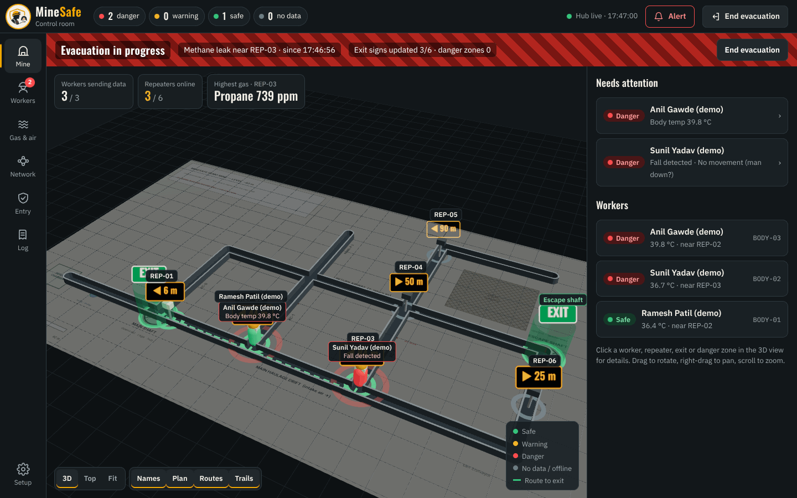
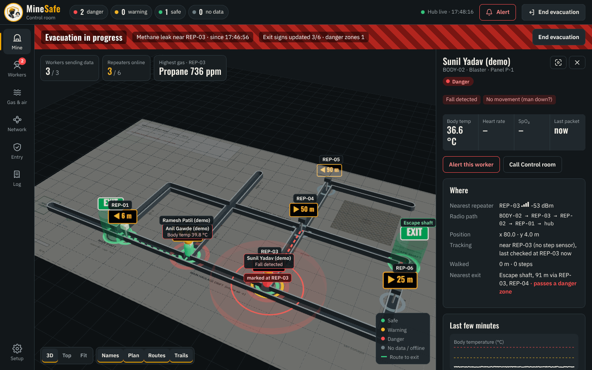
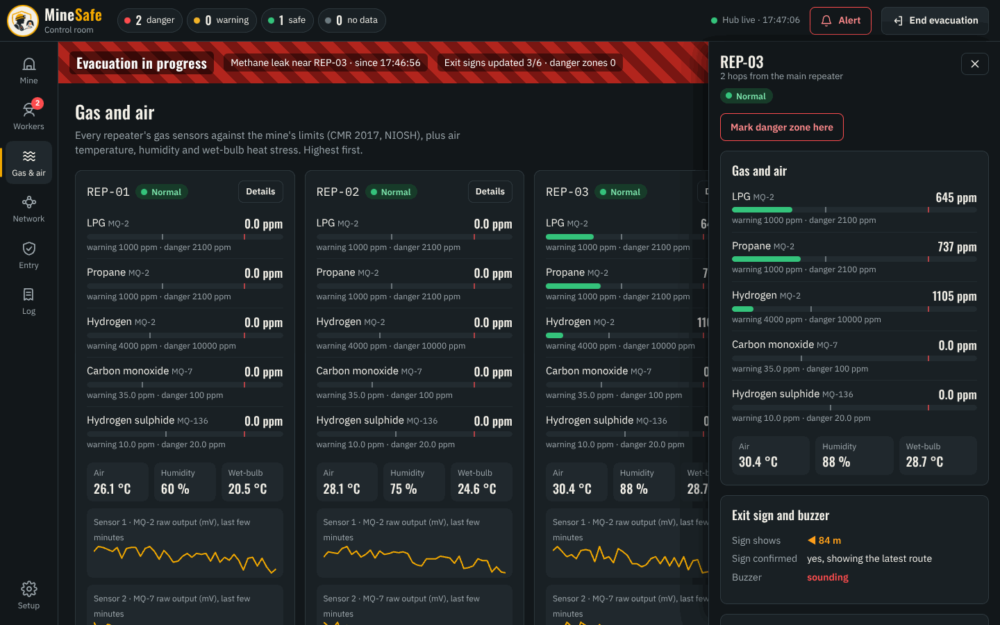
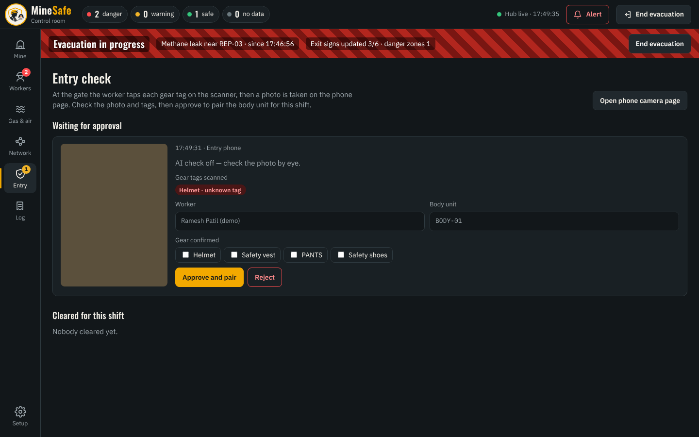
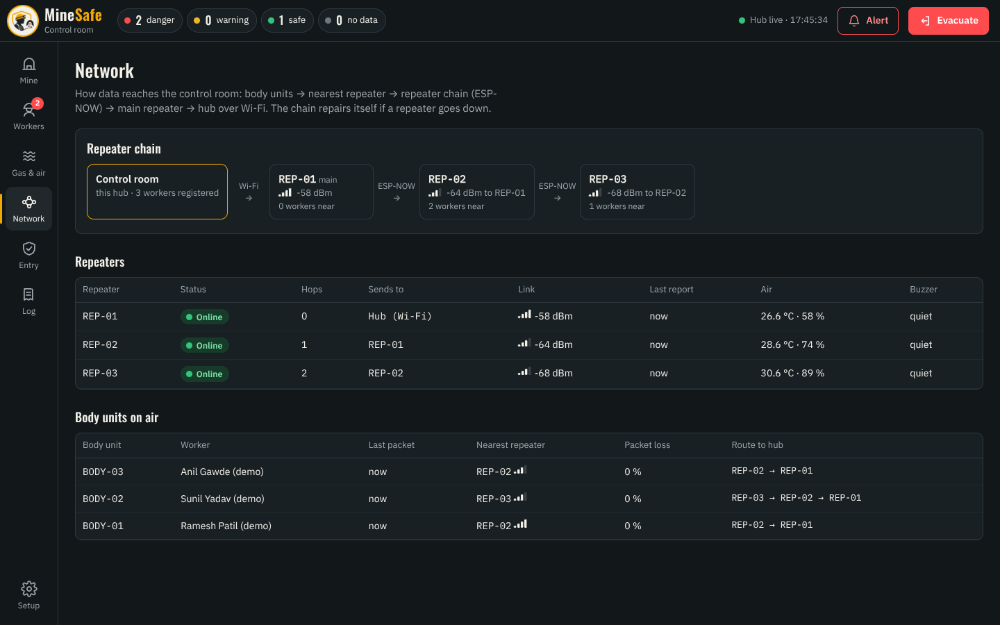
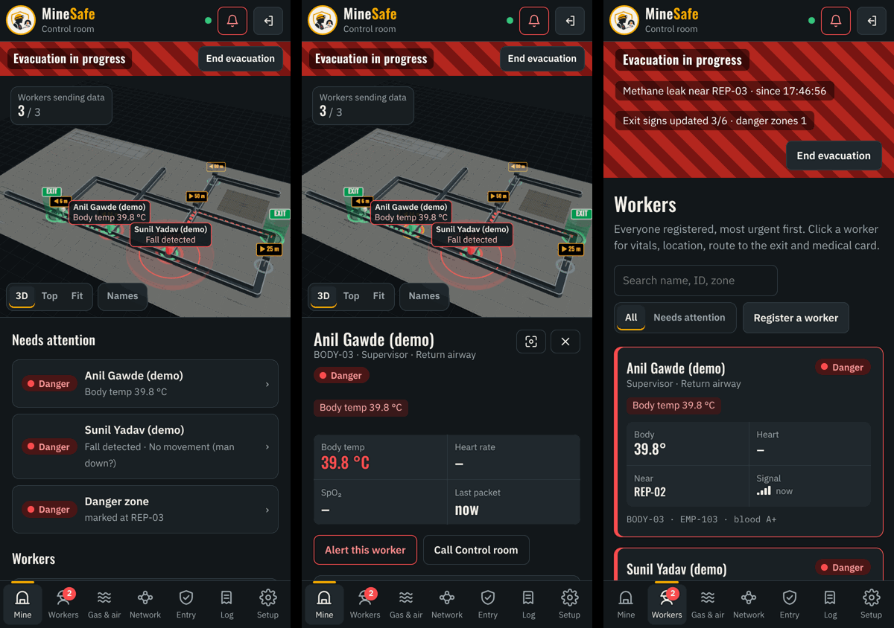

# MineSafe Control — the 3D control-room app

A full control-room app for monitoring the mine. It shows the mine in 3D with every worker, repeater, exit sign, danger zone and evacuation route, and lets the control room alert, evacuate and approve entry. It runs **only on live data** from the admin hub: real body units, repeaters, the scanning station and the phone page. There is no simulation inside the app.

Open it at **`http://<laptop-ip>:5000/control/`** (on the laptop: `http://localhost:5000/control/`). The classic admin page (`/`) has a **3D control room** button, and the app's **Setup** button goes back to it.



## What's in it
| Page | What you do there |
|---|---|
| **Mine** | 3D mine built from the hub's map: tunnels, exits, repeaters with their live exit signs (arrow + distance during an evacuation), workers coloured by status with name tags, danger zones, each worker's route to the nearest exit, trails, and the mine plan on the floor. Next to it, a *Needs attention* list (danger / warning workers, gas, SOS, offline repeaters, unregistered body units, entry checks waiting). Click anything for details. |
| **Workers** | Every registered worker, most urgent first, with search. Details: vitals with limits, where they are and how the position was found, radio path, nearest exit and route, last few minutes of body temperature / heart rate / movement, medical card, *Alert this worker*, *Call contact*. |
| **Gas & air** | Every repeater's gas readings against the limits (CMR 2017 / NIOSH), wet-bulb heat stress, sensor trends. *Mark danger zone here* on any repeater. |
| **Network** | The repeater chain, link strength, offline repeaters, every body unit's packet loss and route to the hub. |
| **Entry** | Gate checks: photo, scanned gear tags, AI kit result, *Approve and pair* / *Reject*, workers cleared for the shift (*Revoke*). |
| **Log** | Status changes, alerts and evacuations, gear tags scanned. |

Top bar: worker counts, hub connection, **Alert** (all workers or one) and **Evacuate** / **End evacuation**, each with a confirmation. If the hub stops answering, an orange banner says so and the app keeps retrying every second.

Works on a phone (bottom navigation, details as a bottom sheet) — use it on the hotspot at `http://<laptop-ip>:5000/control/`.

| | |
|---|---|
|  |  |
|  |  |



## Running it
Nothing extra to install on the laptop: the built app is in `hub/control/` and `admin_hub.py` serves it. Start the hub as usual (`hub\start_admin.bat` or `python admin_hub.py`).

To **change the app** you need Node.js 20+:
```
cd frontend
npm install
npm run dev        # http://localhost:5173/control/ — live reload, talks to the hub on :5000
npm run build      # writes the finished app into ../hub/control  (commit that folder)
```
`HUB_URL=http://<laptop-ip>:5000 npm run dev` points the dev server at a hub on another machine.

Built with React, Three.js (@react-three/fiber, drei) and TypeScript; fonts are bundled, so it works with no internet (underground sites usually have none).

## Hosting on a dedicated server (product version)
The hub is the server: the website, the API and the data are one Python program. The repeaters and the scanning station must reach it, so **keep a hub on the site network** — if the internet link fails, alarms, exit signs and evacuation still work underground. For remote viewing, put a public server *in front of* it rather than moving it to the cloud.

Recommended setup:
1. **Site server**: a mini-PC (or the laptop) running `admin_hub.py` on the mine's own Wi-Fi/LAN, on a UPS. Repeaters keep posting to it locally.
2. **Remote access**: a secure tunnel (e.g. Cloudflare Tunnel or Tailscale) or a reverse proxy (nginx / Caddy) on your server with **HTTPS** and your domain, forwarding to the site server.
3. A cloud-only hub (repeater posting over the internet to `https://your-domain/api/telemetry`) is possible — the ESP32 can use HTTPS — but every alarm then depends on the internet link, so it is not recommended for safety.

**Must be added before the website is public** (not in the hub yet):
- **Login and roles** — today anyone who can open the page can trigger an alert or an evacuation and read medical cards. Needed: user accounts (admin, control room, viewer), sessions, and checks on every POST endpoint.
- **Device keys** — `/api/telemetry` and `/api/gear` accept any device; each repeater / station should send a secret key.
- **HTTPS** (from the proxy / tunnel) and a production web server (e.g. `waitress` or `gunicorn`) instead of Flask's built-in one.
- **Stored history** — readings and incidents live in memory; a small database (SQLite / PostgreSQL) keeps shift records and reports.

The app already supports being hosted apart from the hub: open it with `?hub=https://your-hub-address` (remembered on that device) or build with `VITE_HUB_URL=…`; the hub then needs CORS enabled for that address.
