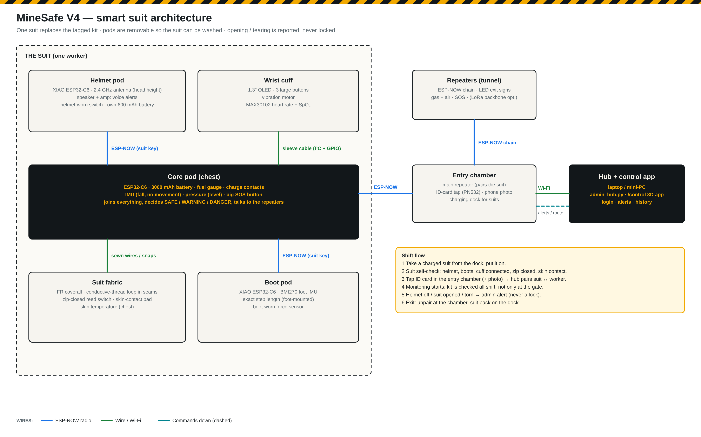

# MineSafe V4.0 — the smart suit (planned)

**Status: design stage.** V3 is still being calibrated ([v3.md](v3.md)). V4 replaces the four RFID-tagged kit items with **one smart suit** whose sensors and electronics are built in, and moves the electronics onto our own PCBs.



**Hardware design (PCBs + CAD): [hardware/suit.md](../hardware/suit.md)**


## What changes from V3
| | V3 (now) | V4 (smart suit) |
|---|---|---|
| Kit check | Tap 4 RFID tags (helmet, vest, pants, shoes) once at the gate | The suit checks itself **all shift**: helmet on, boots on, cuff connected, zip closed, worn (skin contact) |
| Wearable | One body unit box with modules and jumper wires | A **core pod** in the chest plus small **helmet**, **wrist** and **boot** pods |
| Worker interface | LED, small OLED, vibration on the body unit | **Wrist cuff**: screen, 3 large buttons, vibration · **helmet speaker**: voice alerts ("Evacuate — go left, 80 m") |
| Location | Steps × fixed step length from a chest IMU | **Boot IMU** measures each real stride (foot-mounted), much closer to the true distance |
| Radio range | Antenna on the body unit | **Antenna in the helmet pod** at head height |
| Entry | RFID tags + phone photo | **ID-card tap** in the entry chamber + phone photo; the **main repeater pairs the suit** and monitoring starts |
| Suit removed / torn | Not detected | **Admin alert** at once (sensing loop in seams and closures, zip switch, skin contact) |
| Electronics | Development boards | Own PCBs, removable pods so the suit can be washed |

## Design rules (from the review of the first idea)
1. **Never lock the worker in.** The suit is not locked by the admin. Opening, tearing or taking it off is **detected and reported**, never prevented; a quick-release always works. A locked suit could trap an injured or overheating worker or block first aid and rescue.
2. **Breathable flame-retardant coverall, not a sealed suit** — mines are hot and humid, and heat stress is one of the things MineSafe measures.
3. **Helmet and boots stay certified separate items.** Their pods clip on and pair with the suit; the suit reports "kit complete" only when every part is connected and worn.
4. **Removable pods.** The coverall is washed daily; the electronics are not.
5. **Glove-friendly controls on the forearm, not on the glove.** Gloves are replaced often and small buttons cannot be pressed with them. A big SOS button sits on the chest.
6. **Radio stays ESP-NOW** from the suit to the repeaters — a moving worker is heard by every repeater in range with no re-joining delay. The ESP32-C6 also has a Zigbee radio, and LoRa is the planned long-range repeater backbone ([decisions.md](decisions.md), #16).
7. **Intrinsic safety** (low-energy electronics, protected battery, certification) is required for gassy coal mines in a real product — noted as product work, not part of the capstone build.

## Architecture
```
THE SUIT
  Helmet pod  (XIAO ESP32-C6, antenna, speaker, helmet-worn switch) ─┐ ESP-NOW (suit key)
  Wrist cuff  (OLED, 3 buttons, vibration, MAX30102)  ── sleeve cable ─┤
  Boot pod    (XIAO ESP32-C6, BMI270 foot IMU, boot-worn sensor)  ─────┤ ESP-NOW (suit key)
  Suit fabric (tear loop, zip switch, skin contact, skin temperature) ─┤ sewn wires / snaps
                                                                       ▼
  Core pod (chest): ESP32-C6, 3000 mAh battery, IMU, pressure, SOS button
        │  status, vitals, position, kit state — 1 packet / s (ESP-NOW broadcast)
        ▼
  Repeaters (ESP-NOW chain, LED exit signs, gas, SOS) ──► Main repeater (entry chamber) ── Wi-Fi ──► Hub + 3D control app
        ▲                                                                                              │
        └──────────────── alerts, evacuation route, voice / screen messages ◄─────────────────────────┘
```

- **Core pod** is the suit's brain. It reads the fabric sensors and the cuff over wires, receives the helmet and boot pods over ESP-NOW (encrypted with a key unique to that suit), decides SAFE / WARNING / DANGER locally, and sends one packet a second to the repeaters — the same chain, hub and app as V3.
- **Helmet pod** carries the antenna (higher = better range) and the speaker. It has its own small battery, so a knocked-off helmet keeps reporting "helmet off".
- **Wrist cuff** is the worker's screen and buttons (OK / menu / SOS) with vibration; it also holds the heart-rate sensor.
- **Boot pod** gives accurate step length and "boots on".
- **Entry chamber**: main repeater + ID-card reader + charging dock. The hub links suit ↔ worker at the tap.

### Shift flow
1. Take a charged suit from the dock and put it on.
2. Suit self-check: helmet, boots, cuff connected, zip closed, skin contact — the cuff shows what is missing.
3. Tap the ID card in the entry chamber (and the phone photo for the AI kit check) → hub pairs the suit to the worker → monitoring starts.
4. During the shift the kit is checked continuously; helmet off / suit opened / suit torn → admin alert and a message on the cuff.
5. Alerts and evacuation: voice in the helmet, vibration + direction on the cuff, LED exit signs on the repeaters.
6. Exit: unpair at the chamber, suit back on the dock to charge.

### Sensor placement
| Measurement | Where | Part |
|---|---|---|
| Heart rate, SpO₂ | Inside of the wrist (cuff) | MAX30102 → MAX30101 |
| Skin temperature | Chest / under the arm (suit) | DS18B20 → MAX30208 patch |
| Fall, no movement, heading | Chest (core pod) | MPU6050 → BMI270 |
| Step length (position) | Heel (boot pod) | BMI270 + FSR |
| Level / depth | Chest (core pod) | BMP180 → BMP390 |
| Suit worn | Chest lining | skin-contact pad + skin temperature |
| Suit closed / torn | Zip end + seams | reed switch + conductive-thread loop |
| Helmet on / boots on | Head harness / boot | micro switch / FSR |

## Bill of materials — one suit prototype
Full list with every part: [v4_bom.csv](v4_bom.csv). Prices are approximate Indian online prices (Oct 2026) — check before ordering.

| Part of the suit | Main parts | ≈ ₹ (all parts) | ≈ ₹ to buy (we already have some) |
|---|---|---|---|
| Core pod (chest) | ESP32-C6, 3000 mAh battery, charger, regulator, fuel gauge, IMU, pressure, SOS button, charge contacts, case | 2,790 | 2,040 |
| Helmet pod | XIAO ESP32-C6, antenna, I²S amp + speaker, 600 mAh battery, helmet switch, helmet, housing | 2,260 | 2,260 |
| Wrist cuff | 1.3" OLED, 3 large buttons, vibration motor, MAX30102, sleeve cable + IP67 connector, cuff case | 1,480 | 1,260 |
| Boot pod | XIAO ESP32-C6, BMI270, 300 mAh battery, force sensor, safety boots, clip | 3,270 | 3,270 |
| Suit fabric + sensing | FR coverall, conductive thread, snaps, zip reed switch, skin probe, contact pad, pockets | 3,040 | 2,940 |
| **One suit** | | **≈ 12,800** | **≈ 11,800** |
| Entry chamber (once per site) | main repeater + PN532 (have), ID cards, 4-slot charging dock | 1,290 | 1,290 |
| Repeaters | v3.3 repeaters ([final_bom.md](final_bom.md)) — unchanged | ≈ 2,300 each | — |
| Optional LoRa backbone | SX1262 module + 868 MHz antenna per repeater | ≈ 900 each | — |

The helmet and boots (₹2,000 together) are the certified items a mine already issues; without them one suit's electronics and coverall come to about **₹10,800**.

## Build plan
1. **Capstone demo (now):** core pod + wrist cuff + helmet pod on a coverall, using the current body-unit code (V3.4 display / vibration move to the cuff). Show tear / zip / helmet-off alerts on the 3D control app.
2. **Then:** boot pod with foot-mounted step length; ID-card pairing in the entry chamber; voice alerts.
3. **Product (V4):** own PCBs — the **repeater PCB + mine-rated case** ([hardware/README.md](../hardware/README.md)) and the **four suit pod PCBs + enclosures + full-suit CAD** ([hardware/suit.md](../hardware/suit.md)) are designed; moulded IP65 cases, sizes of coverall, intrinsic-safety design, LoRa backbone for long tunnels.

Firmware and the hub keep the same packet and API; the hub gains kit-state fields (helmet / boots / zip / torn / worn) and the control app shows them.
