# Control-room website (admin hub)

The website is `hub/admin_hub.py` — one Python file (Flask) that serves every page below. It runs on the laptop, not on the internet: start it with `hub\start_admin.bat` (or `python admin_hub.py`) and open `http://localhost:5000`; phones on the same hotspot use `http://<laptop-ip>:5000` (see [run_on_laptop.md](run_on_laptop.md)).

Screens captured on 13 Oct 2026 (v3.4) with the [demo mine map](../tools/demo_map/), the repeater simulator (`tools/sim_repeater.py … gas`) and three **fictional demo workers**.

## Opening screen
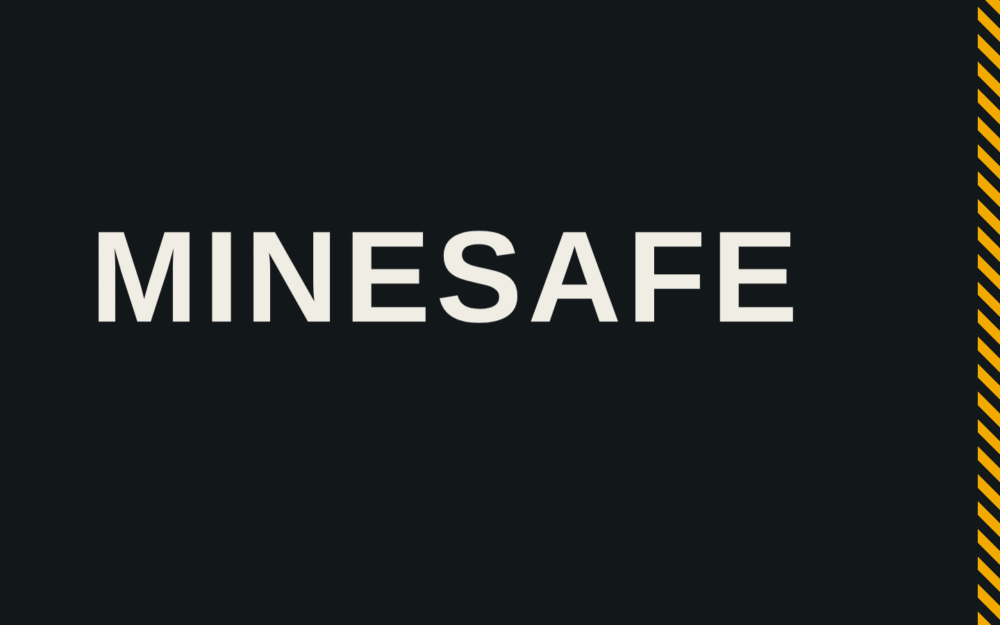

## Live — every worker as a card (body temperature, heart rate, signal, alarms)
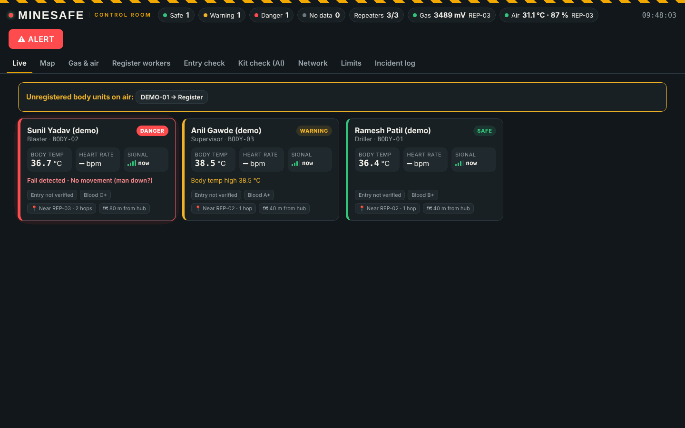

## Map — tunnel plan, workers, repeaters, exits
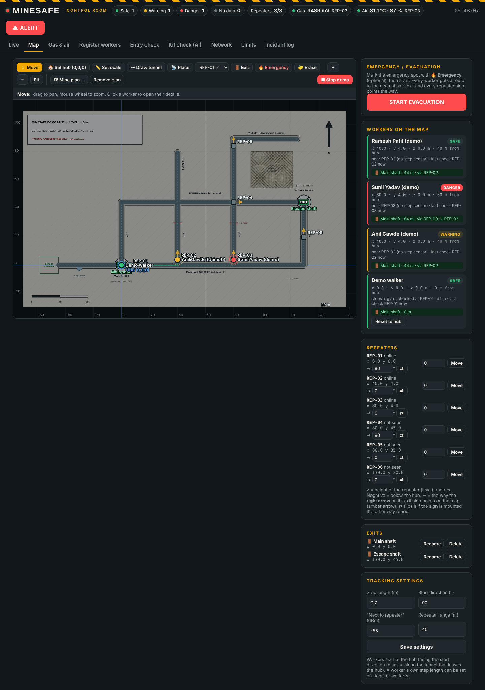

## Evacuation — danger zone, safest route for every worker, arrow + distance on every exit sign
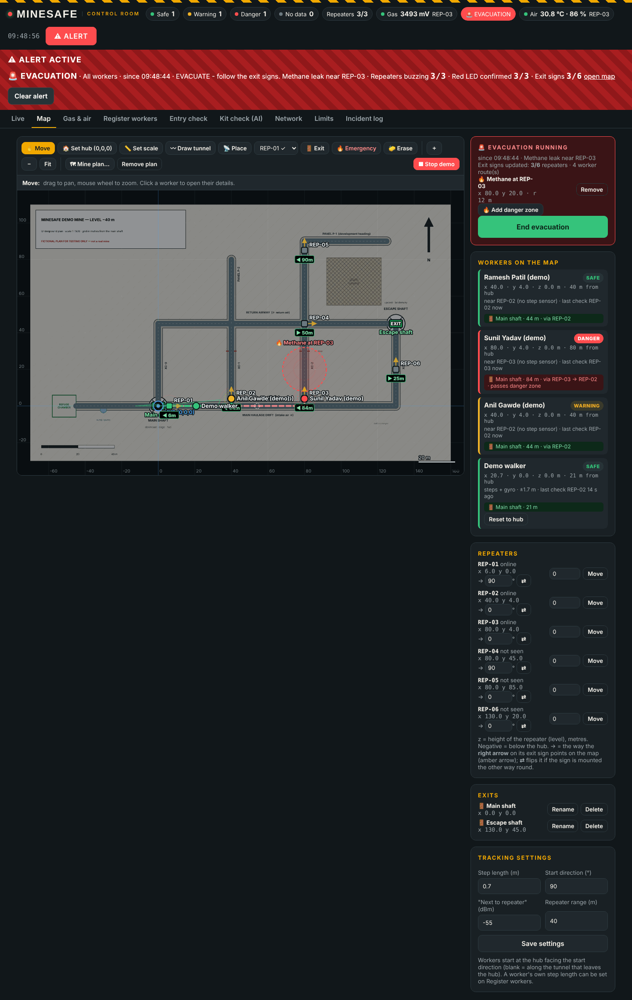

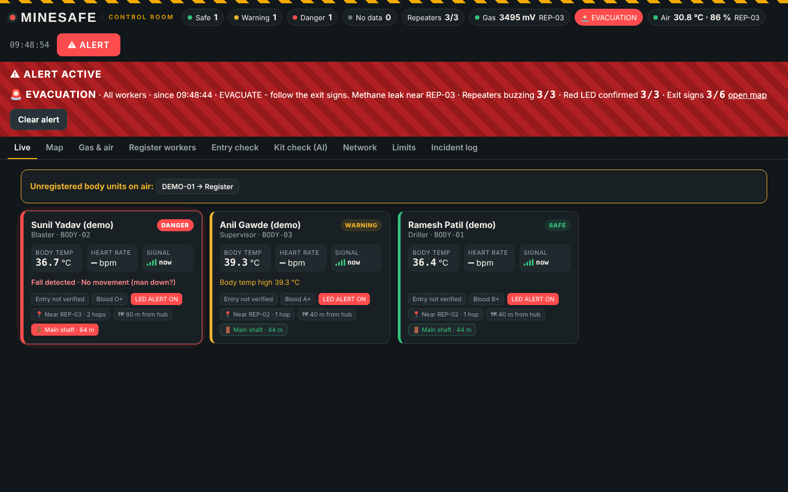

## Gas & air — every MQ channel per repeater, air temperature / humidity / wet-bulb
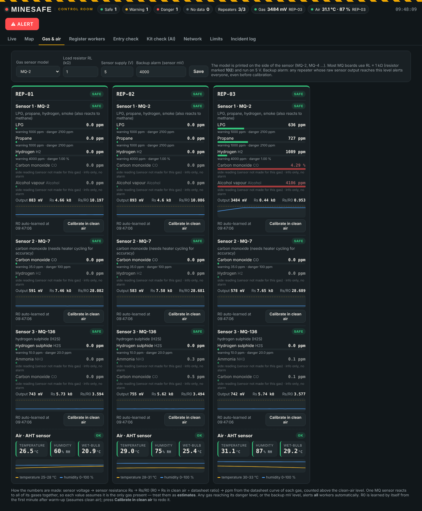

## Limits — warning / danger / alarm level for every gas (CMR 2017, NIOSH / OSHA)
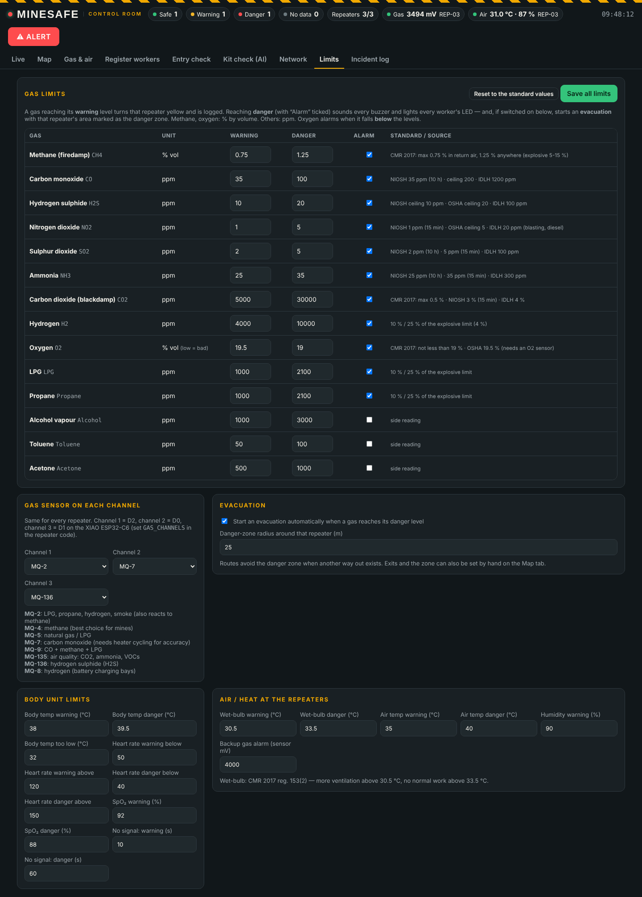

## Network — the repeater chain and every body unit's route
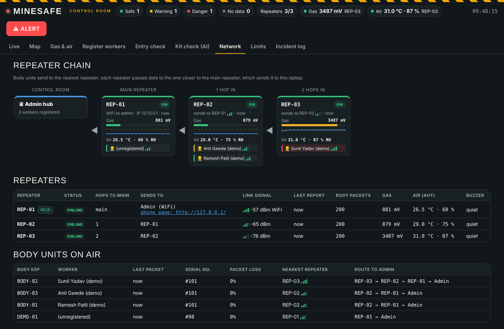

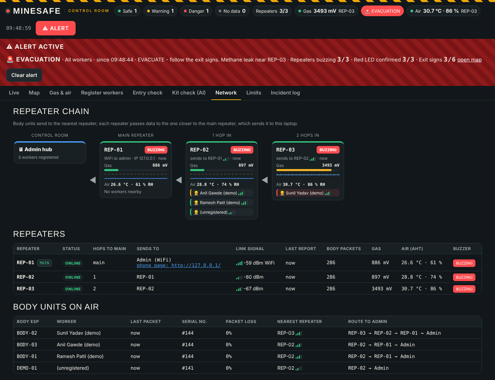

## Register workers
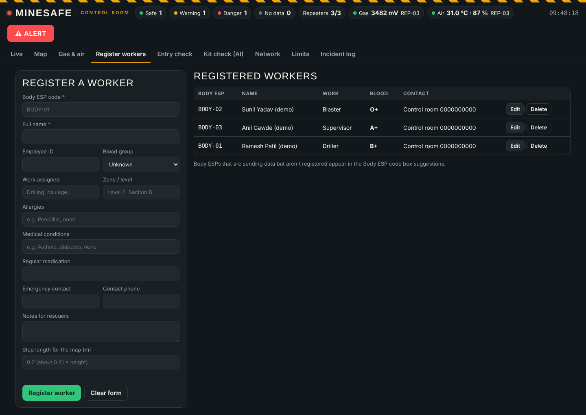

## Entry check, kit check (AI) and incident log
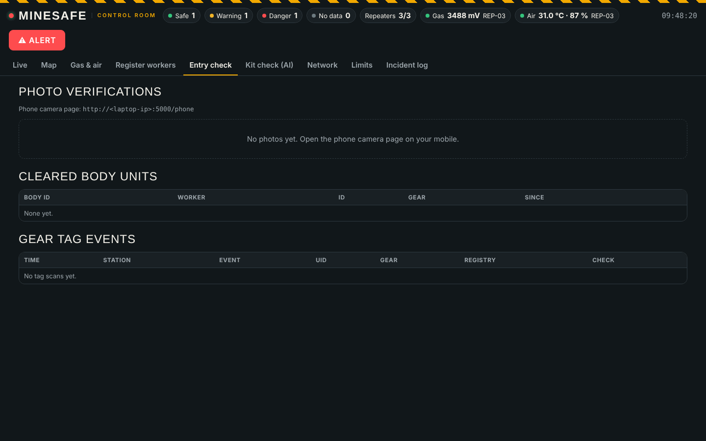

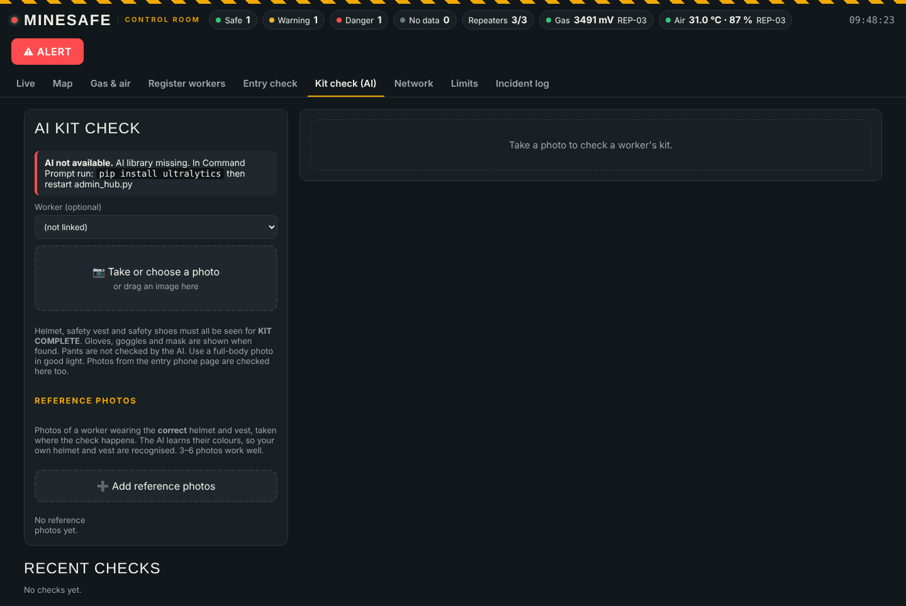

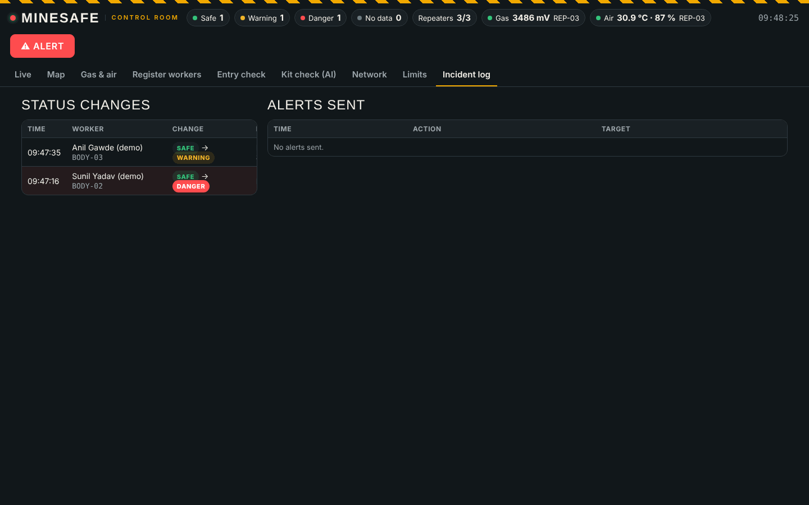

## Phone page (`/phone`) — entry photo for the kit check
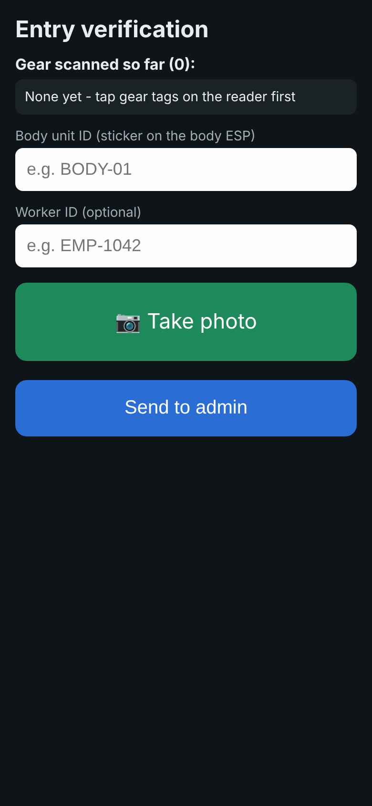

## Body unit display (v3.4)
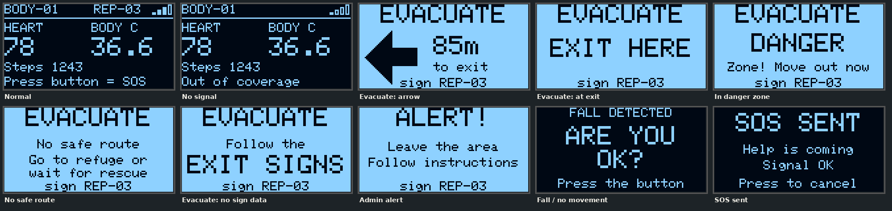
