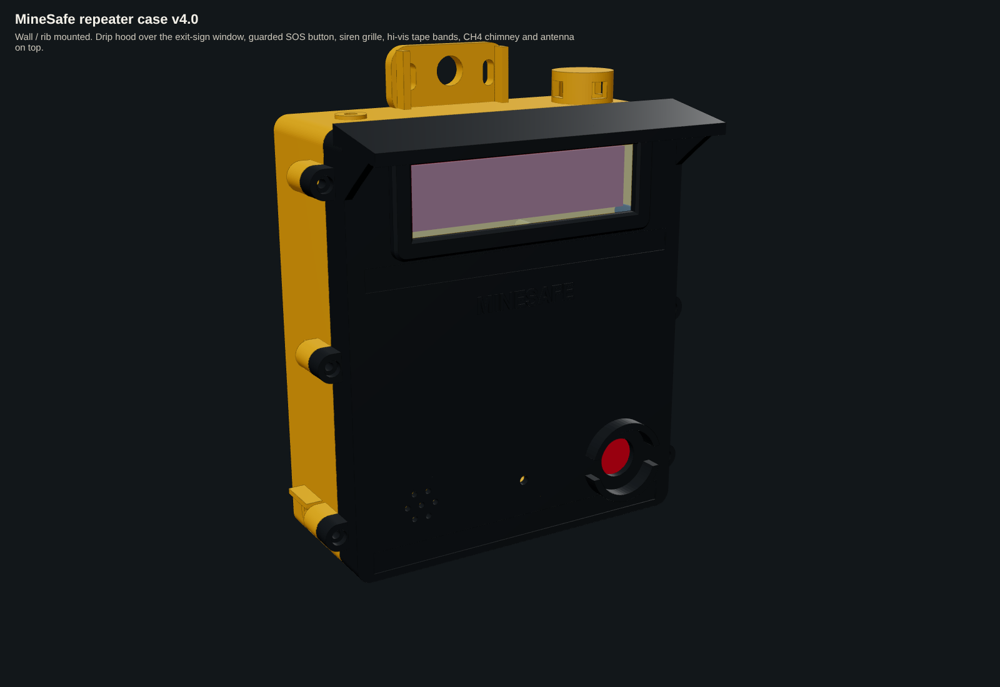
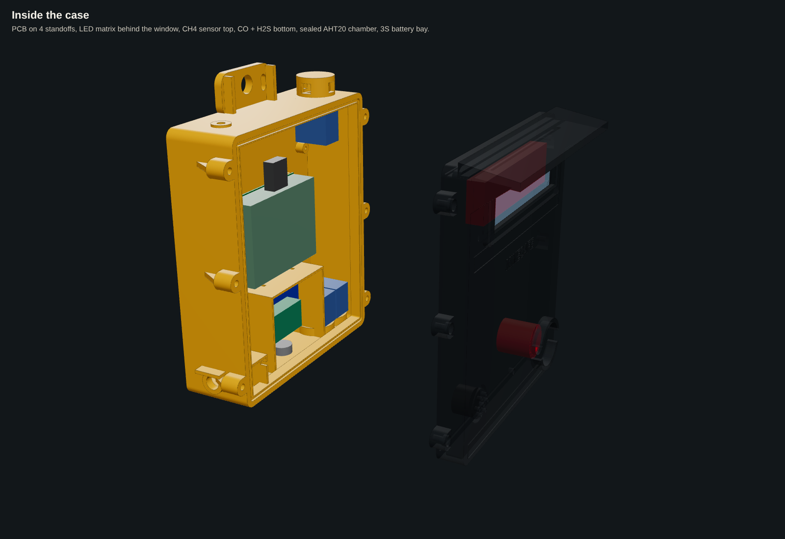
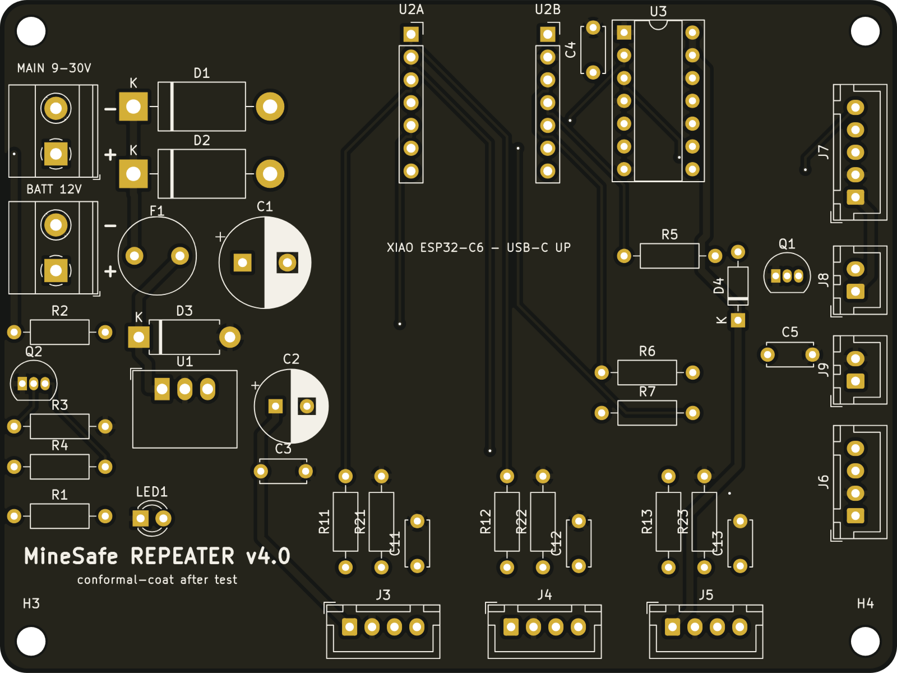
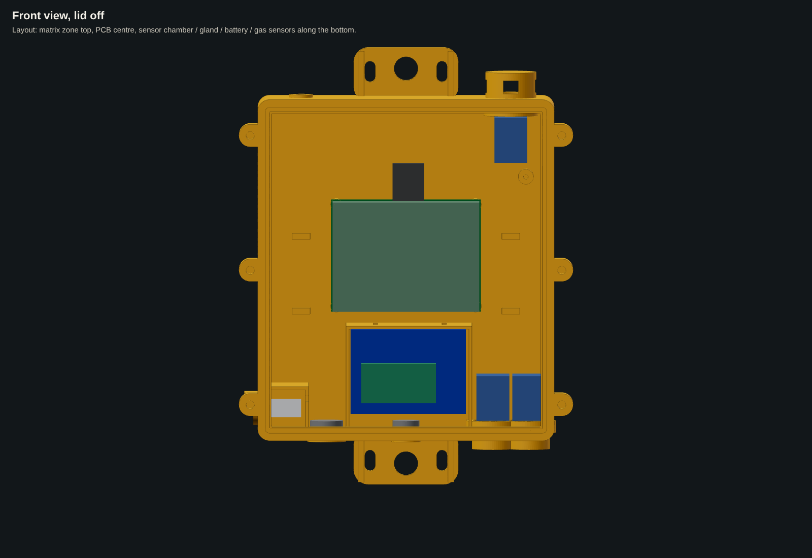
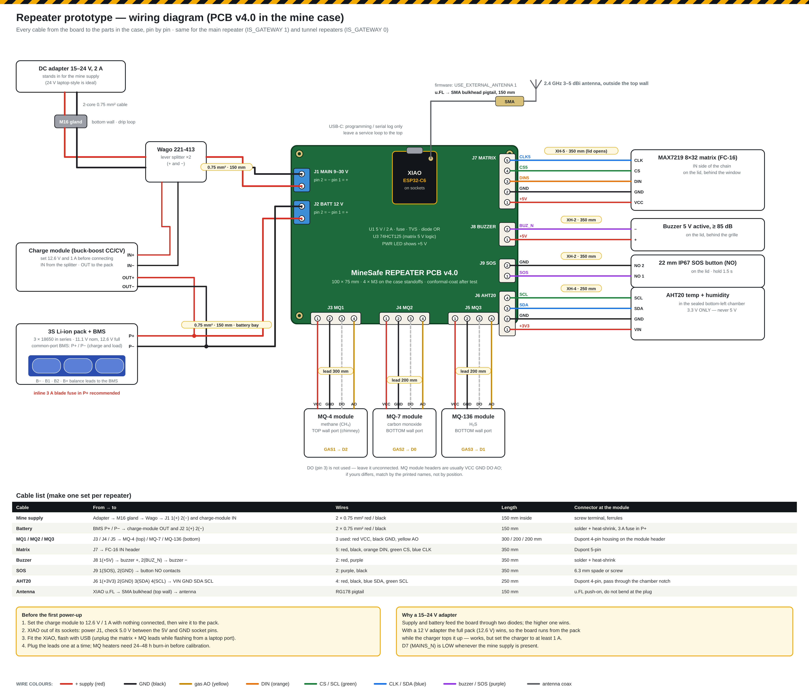

# MineSafe hardware — repeater PCB v4.0 and case

> V4 smart suit pods (4 PCBs + enclosures + full-suit CAD): see **[suit.md](suit.md)**.

This replaces the breadboard / jumper-wire repeater with **one carrier PCB** for the Seeed XIAO ESP32-C6 and a **mine-rated enclosure** designed around it. It uses the same pins as `firmware/repeater_node` (v3.3), so the firmware runs unchanged. Set `GAS_CHANNELS 3` to use all three gas inputs.

| | |
|---|---|
|  |  |
|  |  |

## What a repeater has to survive underground — and how the design answers it
| Mine condition | Design answer |
|---|---|
| **Water**: roof drips, wet walls, hosing-down, humidity up to 100 % | Sealed base and lid: a 3 mm silicone cord in a groove on a 9 mm land, with a tongue on the lid that presses it (aim **IP65**). A **drip hood** over the window. Every opening that could collect water faces **down**: the power gland, the pressure vent, and the CO and H₂S ports. The side vent of the AHT20 chamber sits under a drip lip. Conformal-coat the PCB after testing. |
| **Dust** (coal and rock dust) | Same seal. Every sensor breathes only through a **sintered-bronze disc and an ePTFE membrane**, never through open holes. |
| **Methane, which is lighter than air**, collects at the roof | The **MQ-4 (CH₄)** port is in the **top** wall. It sits under a "chimney" with side windows, so gas gets in but drips cannot fall onto the membrane. |
| **H₂S, which is heavier than air**, and CO | The **MQ-136 (H₂S)** and **MQ-7 (CO)** ports are in the **bottom** wall. Short skirts protect them from knocks. |
| **Gas ignition risk** (hot MQ heaters, sparks) | Each sensor port has a seat for a **sintered flame-arrestor disc**. The sensor board screws onto a foam gasket, so the heater only "sees" the outside through that disc. ⚠ A real coal-mine product still needs intrinsic-safety design and certification (Ex ia / Ex d). This case is a capstone prototype and is **not certified**. |
| **Heat** (30–45 °C) plus the MQ heaters (≈ 0.75 W each) | The **AHT20 sits in its own walled chamber** in the bottom-left corner. It has its own vent, far from the heaters, so it measures the tunnel air and not the box. A switching regulator (K7805, ≈ 90 % efficient) replaces a hot linear 7805. |
| **Blasting shock and vibration** | All boards are on screw bosses, with no hot glue and no breadboard. The XIAO and the 74HCT125 sit in sockets with a cable-tie. JST-XH latching connectors are used throughout. The lid lugs have gussets, and the mounting tabs have ribs. Fit **rubber grommets** in the 16 mm mounting holes. |
| **Falling rock, knocks from machines** | 3.5–4 mm walls in PC-ABS FR. The window is **3 mm polycarbonate** set in a recess behind a raised bezel. The SOS button has a **guard ring** with finger gaps, so a passing load cannot press it but a gloved hand can. |
| **Mine power cuts** | Two inputs: **MAIN 9–30 V** (mine supply) and **BATT 12 V** (3S 18650 pack with BMS). They are joined through Schottky diodes, so the board switches to battery with no reset. A **mains-present signal** (Q2 → D7) lets the firmware report "running on battery". On the input: a 1.6 A slow fuse, a 36 V TVS and a 470 µF capacitor. |
| **Radio in a rock tunnel** | The XIAO's u.FL connector goes through a pigtail to an **SMA bulkhead on the top wall**, so the antenna sits outside the box and clear of the rock face. |
| **Visibility in smoke and darkness** | The LED-matrix exit sign is under the hood, at eye level when the box is mounted on the rib. Two recesses take **reflective hi-vis tape**, which shows up in cap-lamp light. A power LED shows through a light pipe. |
| **Mounting** on the rib, a rock-bolt plate, roof mesh or a chain | Top and bottom tabs with a 16 mm hole (grommet, bolt or hook) and two slots each. Hang the box with the top tab only from roof mesh, or bolt both tabs to the rib. |
| **Static electricity** | Use antistatic FR plastic. An **earth stud boss** inside bonds the box to the mine earth. |
| **Pressure and temperature swings** (ventilation fans, depth) | An M12 **ePTFE pressure vent** in the bottom wall stops the seal from "breathing" water in. |

## Wiring the prototype

Every cable from the PCB connectors to the parts in the case, pin by pin, with lengths and wire colours. Generated by `docs/wiring/make_repeater_v4_wiring.py`. Shopping list for two repeaters: [`repeater_x2_shopping_list.xlsx`](repeater_x2_shopping_list.xlsx).

## PCB — `repeater_pcb/`
- **Board**: 100 × 75 mm, 2 layers, 1.6 mm, ground pour on both layers. Every part is through-hole, so the team can hand-solder it. 4 × M3 holes, 3.5 mm in from each corner.
- **Circuit**: [schematic](repeater_pcb/renders/repeater_schematic.png).
  - **Power**: OR diodes → fuse → TVS → K7805-2000R3 (5 V / 2 A).
  - **Controller**: XIAO ESP32-C6 on sockets.
  - **Matrix driver**: a 74HCT125 lifts the 3.3 V signals to 5 V for the MAX7219.
  - **Gas inputs**: three MQ inputs, each with a 10 k / 20 k divider and a filter capacitor.
  - **Other parts**: buzzer driver (S8050 + flyback diode), SOS input with debounce, AHT20 header with I²C pull-ups.
- **Connectors**:
  - power terminals on the left;
  - MQ1–3 at the bottom;
  - matrix, buzzer, SOS and AHT20 on the right;
  - USB-C at the top for programming.
- **Routing**: autorouted with Freerouting. Power tracks are 0.8 mm, signal tracks 0.3 mm, clearance 0.25 mm. DRC shows 0 unconnected pads. The remaining DRC items are only silkscreen cosmetics and "footprint library not found" (no KiCad library table on the build machine).
- **Source files**: `build_board.py` generates the whole board (placement, netlist, DSN for Freerouting, SES import, zones and silkscreen). `repeater.kicad_pcb` / `.kicad_pro` open in KiCad 7+.
- **Parts list**: [`bom_pcb.csv`](repeater_pcb/bom_pcb.csv), about **₹730 per board** of parts plus about ₹60 for the bare PCB.

### Ordering the PCB (JLCPCB / PCBWay)
1. Upload `repeater_pcb/repeater_gerbers_jlcpcb.zip`.
2. Use the defaults: 2 layers, 1.6 mm, HASL (lead-free if you like), any colour. 5 boards cost about USD 2 plus shipping.
3. No assembly is needed. Solder the low parts first (resistors, diodes), then the sockets, connectors and capacitors.
4. Before fitting the XIAO, power J1 from 12 V. Check for 5.0 V at the U2B "5V" pin and 0 V between the XIAO pins. Then fit the XIAO.

## Case — `repeater_case/`
- **Two parts**: the **base**, which bolts to the wall and carries everything, and the **lid** (window, SOS button, buzzer grille, hood).
- **Outside size**: 223 × 292 × 118 mm, including the mounting tabs and the hood. The body alone is 198 × 228 × 84 mm.
- **Lid fixing**: 6 × M4 stainless screws into heat-set inserts in the base.
- **Files**:
  - `case_base.step/.stl`, `case_lid.step/.stl`;
  - `case_assembly.step`, which includes the PCB, matrix, sensors, battery and button as blocks for the fit check;
  - `build_case.py` (CadQuery), where every dimension is a named constant at the top.
- **Fit check**: `fit_report.txt`. The PCB, matrix, window, 3 MQ modules, AHT20, battery, charger, SOS button, buzzer, gland nut and vent nut clear the case and each other.

**Layout, front view with the lid off:**

| Zone | What sits there |
|---|---|
| Top wall | CH₄ chimney (right), SMA antenna (left) |
| Top of the lid | LED matrix behind the window, under the hood |
| Middle | PCB on 12 mm standoffs. Leave a USB-C service loop at the top. |
| Bottom row | AHT20 chamber with side vent · M16 power gland · battery bay (3S 18650 pack, BMS, charge module, strap slots) · CO and H₂S modules over their ports |
| Front of the lid, lower part | Buzzer grille · power LED · guarded 22 mm SOS button |

**Printing / making:**
- **Prototype**: FDM in **PETG or ASA**, 4 perimeters, 30 % infill. Print the base back-down and the lid face-down. You will need supports under the hood and the lugs.
- **Real use underground**: **PC-ABS FR, V-0 and antistatic** (surface resistance below 10⁹ Ω), injection-moulded or SLS-printed. Ordinary PLA softens at mine temperatures and is not flame-retardant.
- **Window**: 145 × 49 × 3 mm polycarbonate, laser-cut. Seal it with a 1 mm EPDM foam gasket or a bead of neutral-cure silicone.

### Extra parts for the case
| Part | Qty | ≈ ₹ |
|---|---|---|
| Silicone cord 3 mm (gasket), 1 m | 1 | 60 |
| M4 × 25 stainless screws + M4 heat-set inserts | 6 | 90 |
| M16 cable gland IP68 (for 6–10 mm cable) | 1 | 40 |
| M12 ePTFE pressure vent (screw-in) | 2 (bottom + AHT20 chamber) | 200 |
| Sintered bronze disc 25 mm × 3 mm (flame arrestor) | 3 | 180 |
| ePTFE membrane patches 25 mm (or cut from a vent sticker) | 4 | 120 |
| 22 mm IP67 mushroom push button (red, NO) | 1 | 150 |
| SMA bulkhead pigtail (u.FL → SMA female) + 2.4 GHz antenna | 1 | 250 |
| Polycarbonate sheet 3 mm, 150 × 50 | 1 | 60 |
| 3S 18650 pack with BMS (3 × 18650) + 12.6 V CC/CV buck-boost charge module | 1 | 900 |
| Reflective hi-vis tape 12 mm, 0.5 m | 1 | 50 |
| Rubber grommets 16 mm + M3 screws | — | 50 |
| Printing (PETG, ≈ 1.1 kg with supports) | — | 1,000 |
| **Case total** | | **≈ ₹3,150** |

With the PCB (≈ ₹790) and the modules already listed in [`docs/final_bom.md`](../docs/final_bom.md) (XIAO, matrix, MQ sensors, AHT20, buzzer), a complete repeater comes to about **₹6,000**.

## To do
- **Firmware**: read `MAINS_N` on D7 (GPIO17); LOW means mine supply present. Send an "on battery" flag in the status packet and show it on the hub and the 3D control app.
- **Battery charging**: the board does not charge the battery itself. The charge module in the battery bay takes VIN_MAIN and charges the 3S pack at 12.6 V CC/CV. Choose a buck-boost module so that it also works from a 12 V mine supply.
- **Before going underground**: water test (hose, 30 min), drop / impact test, and a 24 h run at 45 °C.
