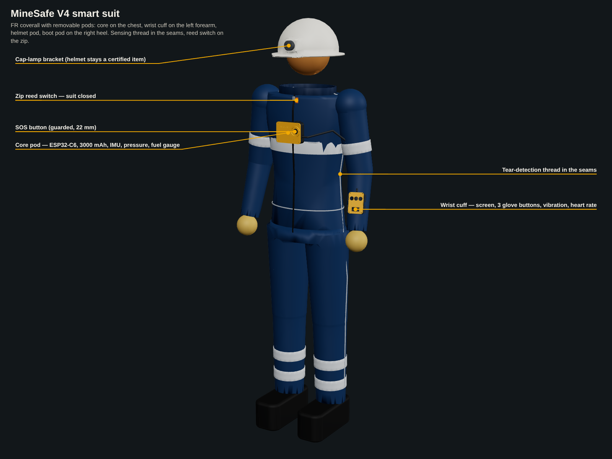
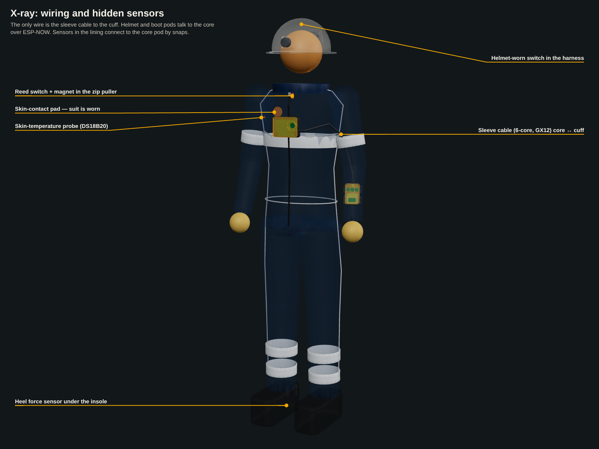
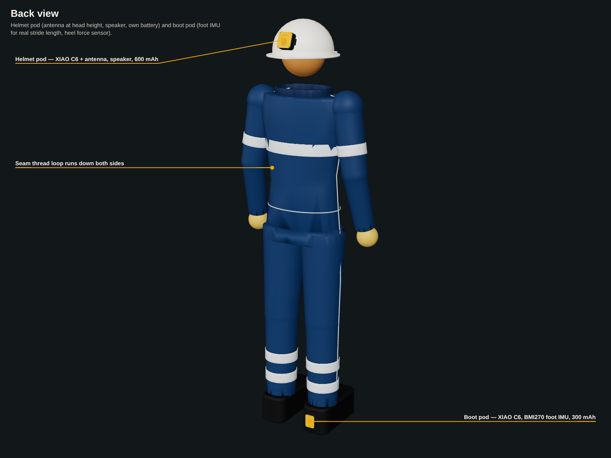
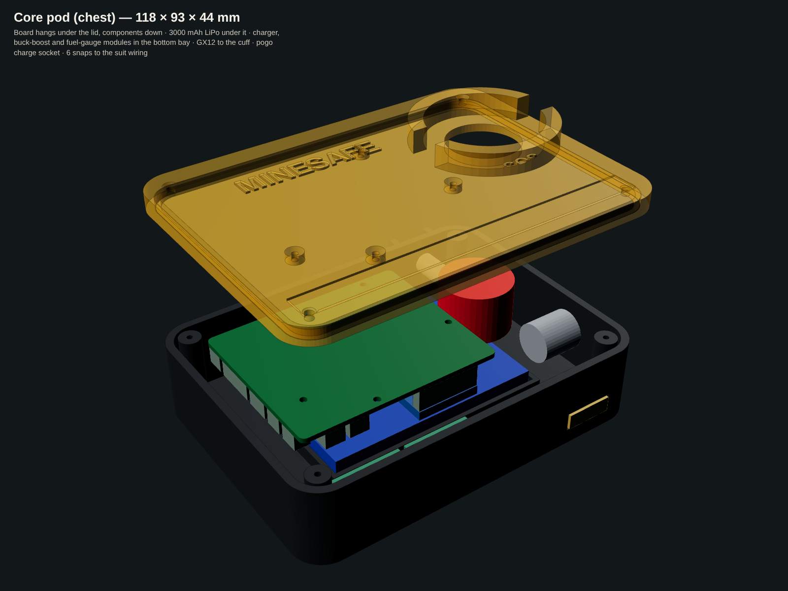
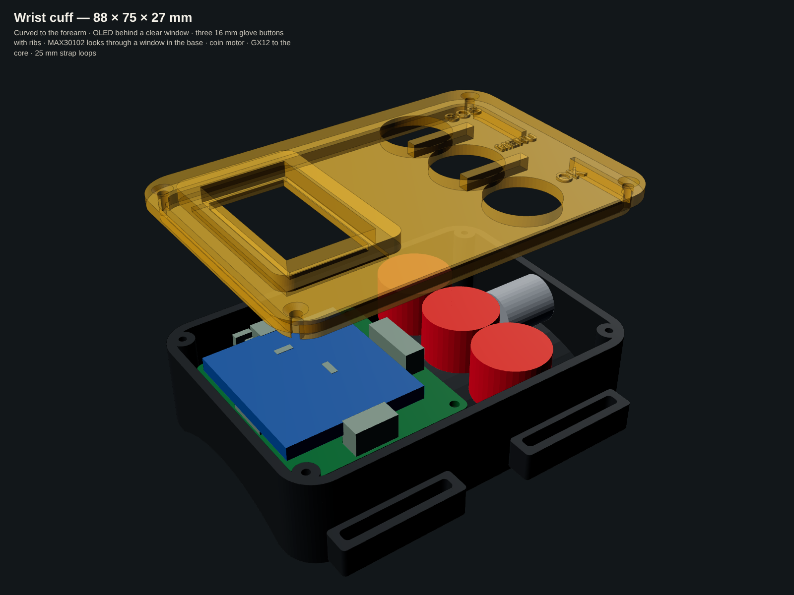
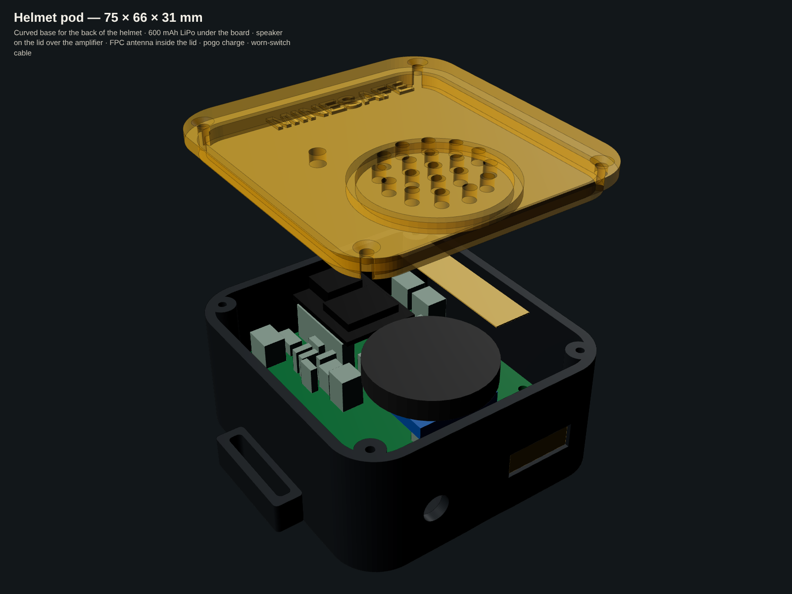
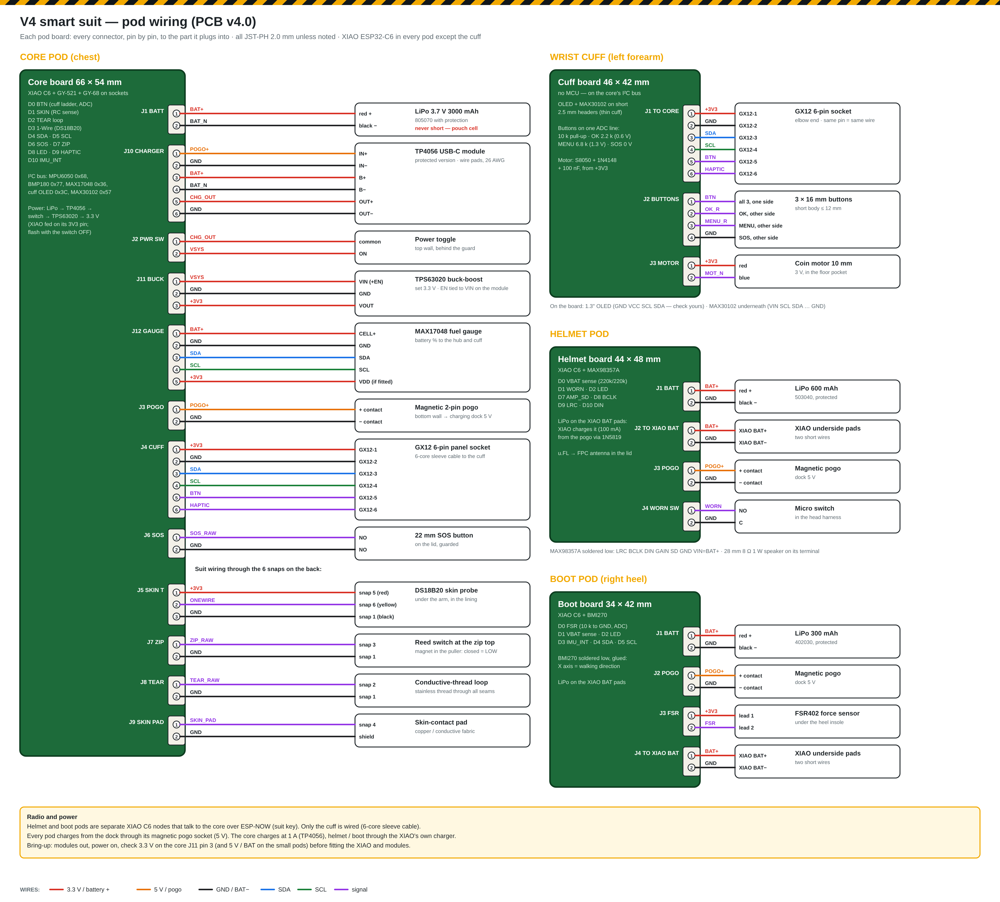

# MineSafe V4 smart suit — CAD and PCBs

The full V4 suit system ([docs/v4.md](../docs/v4.md)) as buildable hardware: **four pod PCBs** and **four pod enclosures**, placed on a 1.75 m mannequin in the FR coverall together with the sleeve cable, the seam tear loop and the zip / skin / helmet / heel sensors.

| | |
|---|---|
|  |  |
|  |  |
|  |  |

## The system
| Pod | Where | Controller | What it carries | Link |
|---|---|---|---|---|
| **Core** | Chest (harness / pocket) | XIAO ESP32-C6 | 3000 mAh LiPo, TP4056 charger, TPS63020 3.3 V, MAX17048 fuel gauge, MPU6050 (fall / no movement), BMP180 (level), guarded SOS button. It reads the suit sensors through 6 snaps. | ESP-NOW to the repeaters, and to the helmet and boot pods |
| **Wrist cuff** | Left forearm | none (on the core's I²C bus) | 1.3" OLED, 3 glove buttons (OK / MENU / SOS), vibration motor, MAX30102 heart rate + SpO₂ against the skin | 6-core sleeve cable with GX12 connectors |
| **Helmet pod** | Back of the helmet | XIAO ESP32-C6 | Antenna at head height (FPC, u.FL), MAX98357A + 28 mm speaker for voice alerts, 600 mAh LiPo, helmet-worn switch | ESP-NOW (suit key) |
| **Boot pod** | Right heel | XIAO ESP32-C6 | BMI270 foot IMU (real stride length), FSR under the heel insole (boot worn + step timing), 300 mAh LiPo | ESP-NOW (suit key) |
| Suit fabric | Seams, zip, lining | — | Stainless conductive-thread tear loop, reed switch + magnet on the zip, skin-contact pad, DS18B20 skin probe | Snaps to the core |

Every pod charges from the dock through a **magnetic 2-pin pogo socket** on its bottom edge. The coverall is washed with the pods removed.

## PCBs — `suit_pcb/`
All four are **2-layer carrier boards with through-hole parts only**. The XIAO and the breakout modules go on sockets or short headers, so the team can solder everything by hand from the V4 parts list ([docs/v4_bom.csv](../docs/v4_bom.csv)).

| Board | Size | Holds | Connectors | DRC |
|---|---|---|---|---|
| `core/` | 66 × 54 mm | XIAO, GY-521, GY-68; pads to the charger, buck-boost and gauge modules | BATT, PWR SW, POGO, CUFF (6), SOS, SKIN T, ZIP, TEAR, SKIN PAD | 0 unconnected |
| `cuff/` | 46 × 42 mm | OLED on top, MAX30102 underneath, button ladder, motor driver | TO CORE (6), BUTTONS (4), MOTOR | 0 unconnected |
| `helmet/` | 44 × 48 mm | XIAO, MAX98357A, battery sense | BATT, TO XIAO BAT, POGO, WORN SW | 0 unconnected |
| `boot/` | 34 × 42 mm | XIAO, BMI270, FSR divider, battery sense | BATT, POGO, FSR, TO XIAO BAT | 0 unconnected |

- **What's in each board folder**:
  - `<board>.kicad_pcb` (open in KiCad 7+);
  - `<board>_gerbers_jlcpcb.zip` (upload as is: 2 layers, 1.6 mm);
  - `bom_<board>.csv` (carrier parts, about ₹100–190 per board plus the PCB);
  - `drc.rpt`;
  - `renders/`.
- **Remaining DRC items** are silkscreen overlaps and "library not configured" warnings only. There are no copper or clearance errors.
- **Generator**: the boards are built by `suit_pcb/boards.py` with the shared generator [`pcbgen.py`](pcbgen.py), which places, auto-packs, routes with Freerouting, adds ground pours, runs DRC and writes the Gerbers. To change a pin, edit the netlist in `boards.py` and run `python3 boards.py core` (or `all`).
- **Pin map**: see the comments in `boards.py` and the wiring diagram below. Firmware notes:
  - The ESP32-C6 has **no capacitive-touch peripheral**, so skin contact is read by RC charge time on D1 (1 MΩ pull-up).
  - The three cuff buttons share one ADC pin (D0): OK ≈ 0.6 V, MENU ≈ 1.3 V, SOS = 0 V.
- **Wiring diagram**: [docs/wiring/suit_v4_wiring.png](../docs/wiring/suit_v4_wiring.png), every connector pin by pin.

## Enclosures — `suit_cad/`
| Pod | Outside size | Design points |
|---|---|---|
| Core | 118 × 93 × 44 mm (incl. harness loops and SOS guard) | The board hangs under the lid, components down. The 3000 mAh pouch cell sits in a tray under it, and the three power modules sit in a bay along the bottom. Also: guarded 22 mm SOS, GX12 on the worker's left (towards the cuff), toggle behind a guard fence, USB-C service port, pogo socket, 6 snap studs, two 25 mm webbing loops, reflective tape recess. |
| Wrist cuff | 88 × 75 × 27 mm | Concave base (R 40) for the forearm. The OLED is behind a clear window with a raised bezel. Three 16 mm buttons are separated by ribs, so one gloved press hits one button. The MAX30102 looks through a 12 mm window in the base (clear acrylic disc). Also: coin-motor pocket, GX12 at the elbow end, four 25 mm strap loops. |
| Helmet pod | 75 × 66 × 31 mm | Spherical back (R 115) to sit on the helmet with a VHB foam pad, plus strap / cable-tie lugs. The battery is under the board. The speaker is in a ring on the lid with a grille, and the FPC antenna is on the inside of the lid. Also: pogo socket, worn-switch cable grommet, LED light pipe. |
| Boot pod | 57 × 58 × 29 mm | Concave back (R 45) for the heel counter, with 20 mm strap loops. The battery is under the board. Also: pogo socket, FSR cable exit, reflective tape. |

- **Fit check**: `fit_report.txt` confirms every pod fits its real board, built in 3D from the KiCad file by `pcb3d.py`, plus the battery, modules, buttons, connectors and speaker.
- **Files**:
  - `pods/<pod>_base|lid.step/.stl` for printing;
  - `suit_assembly.step`, the whole suit with the electronics inside every pod.
- **Rebuild**: `python3 build_suit.py` rebuilds everything, including the render meshes for `renders/viewer.html`.
- **Printing**: PETG or ASA, 3 walls, 25 % infill. Print the bases back-down, with supports under the strap loops. Seal the lid with a 1 mm silicone gasket cut to the rim. Use M2 × 6 self-tapping screws.
- **Real product**: moulded PC-ABS FR, antistatic, and an IP65 seal on every pod. An intrinsically safe battery pack and electronics would need certification for gassy mines.

## Build notes
- **Low-profile modules**: in the cuff, solder the OLED and MAX30102 on **short 2.5 mm headers**, not sockets, so the cuff stays 27 mm thick. Do the same for the MAX98357A in the helmet pod and the BMI270 in the boot pod.
- **BMI270 mounting**: glue the BMI270 board, so the foot IMU cannot rattle. Its X axis points in the walking direction.
- **Core power path**: LiPo → TP4056 (protected) → power switch → TPS63020 → 3.3 V, fed into the XIAO's 3V3 pin. Flash the core with the switch **OFF**.
- **Helmet and boot charging**: the batteries go to the XIAO's own BAT pads; the XIAO charges them at 100 mA from the pogo (5 V), through a 1N5819 diode.
- **Bring-up**: with the XIAO and modules unplugged, power the board and check the rails first: 3.3 V on core J11 pin 3, and battery voltage on the small pods.

## Changes from the V4 plan
- **Core controller**: XIAO ESP32-C6 instead of the large DevKit, so the chest pod stays wearable.
- **Helmet antenna**: a flexible FPC antenna inside the helmet pod instead of an external SMA whip, which could snag in a low roof.
- **Skin contact**: an RC timing pin instead of a "touch" pin, since the ESP32-C6 has no touch sensor.
